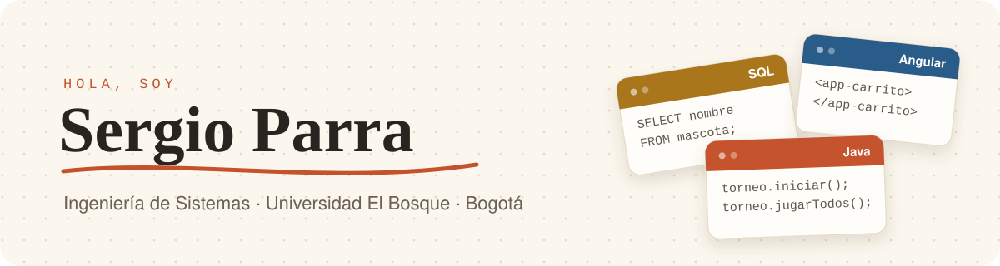
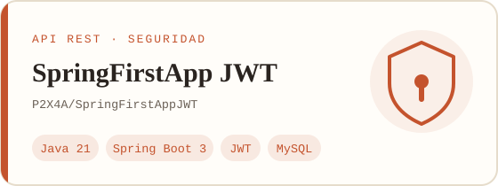
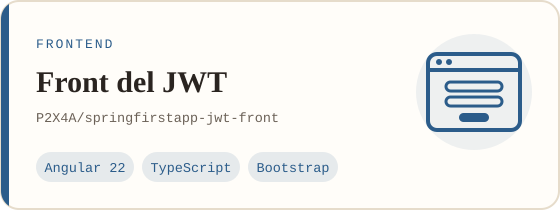
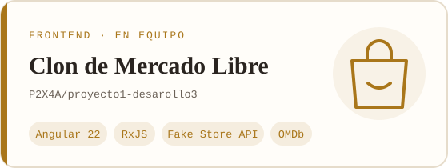
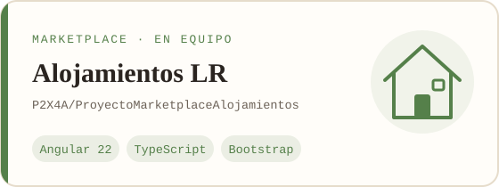
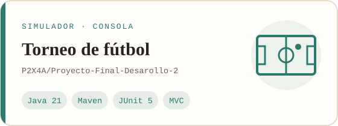
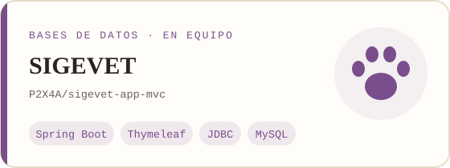

<picture>
  <source media="(prefers-color-scheme: dark)" srcset="assets/banner-oscuro.svg">
  
</picture>

 

Estudio cuarto semestre de Ingeniería de Sistemas en la Universidad El Bosque, en Bogotá. Aprendo construyendo: casi todo lo que veo en clase termina convertido en un proyecto. Empecé con aplicaciones de consola y de escritorio en Java; hoy hago APIs con Spring Boot y frontends en Angular que las consumen.

Aquí reuní los proyectos a los que más cariño les tengo.

## Proyectos

<table>
  <tr>
    <td width="50%" valign="top">
      <a href="https://github.com/P2X4A/SpringFirstAppJWT">
        <picture>
          <source media="(prefers-color-scheme: dark)" srcset="assets/proyectos/springfirstappjwt-oscuro.svg">
          
        </picture>
      </a>
      
API de usuarios con inicio de sesión por JWT, roles USER y ADMIN, contraseñas cifradas con BCrypt y documentación en Swagger.

    </td>
    <td width="50%" valign="top">
      <a href="https://github.com/P2X4A/springfirstapp-jwt-front">
        <picture>
          <source media="(prefers-color-scheme: dark)" srcset="assets/proyectos/jwt-front-oscuro.svg">
          
        </picture>
      </a>
      
El front de esa API. Tiene inicio de sesión, registro y gestión de usuarios; un guard protege las rutas y un interceptor agrega el token a cada petición.

    </td>
  </tr>
  <tr>
    <td width="50%" valign="top">
      <a href="https://github.com/P2X4A/proyecto1-desarollo3">
        <picture>
          <source media="(prefers-color-scheme: dark)" srcset="assets/proyectos/mercado-libre-oscuro.svg">
          
        </picture>
      </a>
      
Réplica educativa de la tienda de Mercado Libre Colombia, con catálogo traído de Fake Store API, buscador, carrito con checkout, CRUD de publicaciones y películas de OMDb. La hicimos entre tres; yo armé la estructura, las rutas, la maquetación, el consumo de las APIs, el CRUD y la integración del carrito.

    </td>
    <td width="50%" valign="top">
      <a href="https://github.com/P2X4A/ProyectoMarketplaceAlojamientos">
        <picture>
          <source media="(prefers-color-scheme: dark)" srcset="assets/proyectos/alojamientos-oscuro.svg">
          
        </picture>
      </a>
      
Marketplace de alojamientos para estadías cortas: filtros, detalle, cotización por noches y reservas simuladas. Fuimos cuatro en el equipo; yo hice el modelo de datos, el servicio de cotización y los componentes de reservas.

    </td>
  </tr>
  <tr>
    <td width="50%" valign="top">
      <a href="https://github.com/P2X4A/Proyecto-Final-Desarollo-2">
        <picture>
          <source media="(prefers-color-scheme: dark)" srcset="assets/proyectos/torneo-oscuro.svg">
          
        </picture>
      </a>
      
Torneo todos contra todos que se simula minuto a minuto: la posesión decide quién ataca y el poder ofensivo, si hay ocasión de gol. Lleva tabla, goleadores y campeón, guarda el torneo en archivos y tiene 31 pruebas con JUnit 5.

    </td>
    <td width="50%" valign="top">
      <a href="https://github.com/P2X4A/sigevet-app-mvc">
        <picture>
          <source media="(prefers-color-scheme: dark)" srcset="assets/proyectos/sigevet-oscuro.svg">
          
        </picture>
      </a>
      
Proyecto final de Bases de Datos 1: la base de una red de clínicas veterinarias, montada en MySQL sobre una máquina virtual con Oracle Linux. En el equipo me tocó verificar la base e integrar las partes. Este repositorio guarda una versión de la app con Thymeleaf y SQL escrito a mano.

    </td>
  </tr>
</table>

También están la [calculadora estilo Windows 11](https://github.com/P2X4A/calculadoraFinalWindows), hecha en Angular con memoria, uso con teclado y 16 pruebas, y mis primeros proyectos de Java, como [localDeMotos](https://github.com/P2X4A/localDeMotos) y [paginasYCafe](https://github.com/P2X4A/paginasYCafe).

## Con qué trabajo

| Área | Tecnologías | Dónde verlo |
| --- | --- | --- |
| Backend | Java 21, Spring Boot 3, Spring Security con JWT, JPA/Hibernate, JDBC, OpenAPI | [SpringFirstAppJWT](https://github.com/P2X4A/SpringFirstAppJWT), [sigevet-app-mvc](https://github.com/P2X4A/sigevet-app-mvc) |
| Frontend | Angular 21 y 22, TypeScript, RxJS, Bootstrap, HTML y CSS | [proyecto1-desarollo3](https://github.com/P2X4A/proyecto1-desarollo3), [springfirstapp-jwt-front](https://github.com/P2X4A/springfirstapp-jwt-front) |
| Java y POO | MVC, DAO/DTO, herencia, interfaces, Swing, archivos y serialización | [Proyecto-Final-Desarollo-2](https://github.com/P2X4A/Proyecto-Final-Desarollo-2), [localDeMotos](https://github.com/P2X4A/localDeMotos) |
| Bases de datos | SQL y MySQL, modelo entidad-relación, normalización, álgebra relacional | [Evidencias en mi portafolio](https://p2x4a.github.io/projects/), [SIGEVET](https://github.com/Estarlan/proyecto-bd1-sigevet) |
| Pruebas | JUnit 5 y Vitest | [Proyecto-Final-Desarollo-2](https://github.com/P2X4A/Proyecto-Final-Desarollo-2), [calculadoraFinalWindows](https://github.com/P2X4A/calculadoraFinalWindows) |
| Herramientas | Git y GitHub, Maven, npm | Todos los repositorios |

## Ahora mismo

Este semestre ando entre Spring Boot, con seguridad por JWT y APIs REST, y el análisis de algoritmos de Modelización Informacional (recurrencias, árboles binarios y complejidad).

## Fuera del código

Cuando no estoy programando, leo sobre fisiología humana y nutrición deportiva, y entreno fuerza. Armé mi primer PC y me gusta flashear custom ROMs.

## Dónde encontrarme

Mi [portafolio](https://p2x4a.github.io) reúne los trabajos de Bases de Datos. Si quieres escribirme, el [formulario de contacto](https://p2x4a.github.io/contact/) me llega directo.

<b>English</b>

 

I'm a fourth-semester Systems Engineering student at Universidad El Bosque in Bogotá. I learn by building, so most of what I study ends up as a project. I started with console and desktop apps in Java; now I build APIs with Spring Boot and Angular front ends that use them.

#### Projects

- [SpringFirstAppJWT](https://github.com/P2X4A/SpringFirstAppJWT): users API with JWT login, USER and ADMIN roles, BCrypt passwords and Swagger docs.
- [springfirstapp-jwt-front](https://github.com/P2X4A/springfirstapp-jwt-front): the Angular front end for that API, with a route guard and an interceptor that adds the token.
- [proyecto1-desarollo3](https://github.com/P2X4A/proyecto1-desarollo3): educational clone of the Mercado Libre Colombia store (Fake Store API catalog, search, cart and checkout, listings CRUD, OMDb movies). Three-person team; I built the structure, routing, layout, API calls, the CRUD and the cart integration.
- [ProyectoMarketplaceAlojamientos](https://github.com/P2X4A/ProyectoMarketplaceAlojamientos): short-stay rentals marketplace with filters, quotes and simulated bookings. Four-person team; I built the data model, the quotation service and the booking components.
- [Proyecto-Final-Desarollo-2](https://github.com/P2X4A/Proyecto-Final-Desarollo-2): round-robin football tournament simulated minute by minute, with standings, top scorers, file persistence and 31 JUnit 5 tests.
- [sigevet-app-mvc](https://github.com/P2X4A/sigevet-app-mvc): team final project for Databases 1, a veterinary clinic database on MySQL in an Oracle Linux VM. I verified the database and integrated the parts; this repo keeps a Thymeleaf version of the app with hand-written SQL.

#### Stack

Java 21, Spring Boot 3 (Security, JWT, JPA), JDBC, MySQL, Angular 21–22 with TypeScript and RxJS, JUnit 5, Vitest, Maven and Git.

#### Right now

I'm working with Spring Boot security and REST APIs, and with algorithm analysis (recurrences, binary trees, complexity).

#### Outside code

I read about human physiology and sports nutrition, and I do strength training. I built my first PC and I like flashing custom ROMs.

#### Contact

My [portfolio](https://p2x4a.github.io) and its [contact form](https://p2x4a.github.io/contact/).

